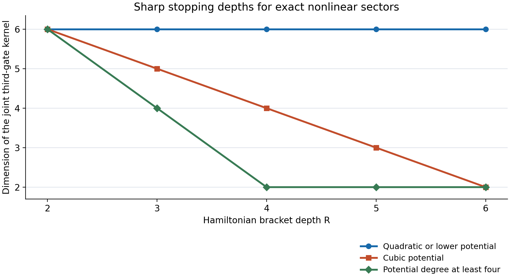

# Exact nonlinear sectors: cubic-phase classification and deformation

Research overlap with `claude/adoring-ritchie-1hq1kw`, incorporating
its cubic-phase work at `35d39be4` and the earlier reviewed integration
at `e6ef82d`, on 22 October 2026.
All results use one canonical pair and the compendium's fixed flat Weyl
convention. Written proofs were reviewed independently inside this research
session; historical priority and external peer review remain open.

## Cubic-phase completion

The continuation through Claude commit `35d39be4` closes the full affine
cubic-phase sector: `P=p+w(q)`, degree w two, `H=a(P)+q*b(P)`.
Theorem CP classifies every such polynomial Hamiltonian, including all
lower-degree boundaries. For degree a at least three, constant b gives
the infinite QC tower; linear b gives exactly the K1-prime spaces of
dimension four, five or six; quadratic b gives exactly K4's three-dimensional
space or `span{1,H}`; and degree b at least three gives `span{1,H}`.
Quadratic b with degree a at most two has a full four-dimensional core.
The full table and exact rational chart recognizer are
`cubic_phase_classification.*`. K1-prime and K4 upper bounds are proved.

The nonlinear restoring theorem is also complete: for EVERY polynomial
F of degree at least three and `lambda!=0`,

`H=F(p+w(q))+lambda*q^2+epsilon*q+C`

has full core `span{1,H}`. Intersections of the third-gate tests through depths one, two and three
have dimensions four, three and two, with explicit all-degree proofs and
sharp witnesses. At zero restoring force the core is instead the infinite
QC tower, sharply at depth one. See `higher_restoring.*`.

The cubic calibration `H_t=(p+q^2)^3+t*q^2` has first-order liftable
initial space `span{1,P,P^3}` and second-order/formal initial space
`span{1,P^3}`. Its delayed P obstruction is `864*t^2`.
The full uniform finite-weight Smith law is in `cubic_deformation.*`;
`restoring_deformation.*` proves the same three-to-two lifting hierarchy
for EVERY polynomial F of degree at least three, with the uniform Smith
law for every declared weight bound N at least twice the degree of F.
The independent review uses its own Fraction engine and imports no
project mathematical producer.

Claude's formal gauge theorem is retained with its parameter convention
explicit. Its vector-field defect is a total derivative and its full
operator defect a coboundary; no nontrivial scalar Gelfand-Fuchs class
is claimed. P003 and P004 remain refuted as stated. General non-affine
cubic-phase Hamiltonians beyond these proved classes remain open.

## The consequential finding

The blanket pure-top part of conjecture P003 is false. The simplest active
counterexample obtained here has degree four:

\[
 Q=p+q^2,\qquad H=Q^2,\qquad
 \mathcal D_\infty(H)=K[Q]+\operatorname{span}_K\{q,qQ,q^2\}.
\]

The failure is structural. With `Q=p+bq^2+cq+d`, `b!=0`, the complete
family `H=P(Q)+epsilon q` has core `K[Q]+Kq` for `deg P>=3`, and the displayed
larger core for `deg P=2`. If `epsilon!=0`, the whole tower `K[Q]` is active.
Consequently a general edge-polynomial finiteness theorem must exclude these
families. A Newton edge alone does not imply a finite core.

A second, different phenomenon has a finite three-dimensional active core:

\[
 J=qp+q^3,\qquad H=qJ^2,
 \qquad\{H,J\}=H,\qquad
 \mathcal D_\infty(H)=\operatorname{span}\{1,H,J\}.
\]

Its extension is a complete classification of all pure total tops with
unequal perfect-power transverse top `alpha p^s(q+gamma)^r`, `r,s>=2`.
For `s>=3` the core is `span{1,H}`. For `s=2`, precisely the explicitly
recognized nonlinear shear family has a third generator.

There is also a complete six-dimensional family. If `Q=p+u(q)`, `deg u>=3`,
and `H=AQ^2+BQ+C+epsilon q`, `A!=0`, the core is exactly
`span{1,q,Q,q^2,qQ,Q^2}`. Third-gate tests at Hamiltonian depths zero, one,
and two suffice, and depth two is necessary. Thus even finite pure cores
need not have dimension two or three.

This six-dimensional sector also connects directly to the compendium's
observer machinery. Its exact derivation matrix has Jordan blocks `3,2,1`
when the forcing vanishes and `5,1` otherwise. The minimal derivative
closures of the targets `q`, `q^2`, and their joint family change from
dimensions `2,3,5` to `3,5,6`. The existing independent observer checker
replays this reduction, and the closed evolution is polynomial in time.

Claude's near-top completion in commit `268d553` is incorporated on the
review branch. The edge theorem and the new pure exceptions have distinct
scopes. Independent review supplied two proof clarifications, without
changing the theorem or its determinant certificates.

## Classification and deformation continuation

The continuation starts from the published review tree at `4050dbf`.

It now classifies **every** polynomial Hamiltonian
`H=A*p^2+B(q)*p+C(q)` with nonzero constant A. Complete the square with
`Q=p+B(q)/(2A)` and `V=C-B(q)^2/(4A)`; the degrees of the shear and
residual potential determine the full core. The complete phase diagram
and unified exact classifier are `constant_quadratic_classification.*`.
The possible answers are the full polynomial ring, the infinite QC
tower, the six-dimensional quadratic sector, and `span{1,H}`.
The sharp third-gate depths reach seven; variable coefficients of p^2
remain outside this completed class.

For `Q=p+u(q)`, `deg u>=3`, and `H=P(Q)+epsilon*q`, `deg P>=3`, the
missing composition case has core exactly `span{1,H}`. The two equations
`C3G=C3DG=0` already determine that core. Together with QC and SS this
completes the main nonlinear shear-composition phase diagram.

Adding a quadratic restoring potential produces exact nonlinear oscillators.
For nonzero `A` and `deg u>=3`, the core
remains the six-dimensional quadratic sector in `(q,Q)`, with sharp
third-gate depth two. For a quadratic shear and `kappa!=0`, the same core
has sharp depth three. At `kappa=0` a quadratic shear instead has the
infinite QC core. Thus a quartic polynomial Hamiltonian exhibits an exact
infinite-to-six transition, and the closed sector can carry oscillatory
rather than merely polynomial-in-time dynamics.

The whole constant-quadratic-momentum higher-shear family is classified:
for `H=A(p+u(q))^2+V(q)`, `deg u=m>=3`, and arbitrary polynomial V,
the core is six-dimensional if `deg V<=2` and is `span{1,H}` otherwise.
The sharp third-gate stopping depths are respectively two, six when
`deg V=3`, and four when `deg V>=4`. A direct leading-transverse-degree
argument removes the initially excluded resonant boundary `deg V=2m`.
For the subfamily `deg V<2m`, the weighted bound remains a useful
independent certificate method: every core observable has `(1,m)` weight
at most `2m`, and exact elimination in `3m+3` ambient monomials computes
the core without any unproved numerical cutoff.

For analytic `H=q*p^(-1/4)+V(p)` on `p>0`, an additional cubic exists
exactly when `V=c0+a*p^(-1/4)+b*p^(3/4)+c*p^(5/2)`. Its full core is then
`A+qA+R*(H-c0)^3`; otherwise it is the affine strip. The proof solves a
fourth-order Euler compatibility equation, rather than searching a list
of powers. A general regular-chart compatibility system also describes
which potentials preserve a cubic for exceptional `F` with constant `K3`.

For `H_t=(p+q^2)^2+t*q^2/2`, the deformation obstruction hierarchy is
nontrivial in all degrees: at order zero the core is infinite, the space
of initial observables liftable through first order has dimension seven,
and through second order has dimension six. The cubic lifts once but is
obstructed at the next order; every higher power is obstructed already at
first order. The six-dimensional quadratic sector persists to all orders.
The full graded torsion of the declared gate-matrix cokernel is one
`K[t]/(t^2)` summand in degree three and one `K[t]/(t)` summand in every
degree at least four. This is literal module torsion and an explicit
deformation obstruction, not a newly named geometric torsion tensor.

Proofs and checkers are in `shear_composition_complete.*`,
`shear_oscillator.*`, `quadratic_frontier.*`,
`analytic_potential_classification.*`, and `deformation_obstructions.*`.
The independent review is `extension_proof_review.md`. Universal claims
rest on the written proofs; exact finite checks and certificates replay
those claims within their declared hypotheses. Historical priority remains
unestablished.

## Other proved overlaps

For `J=qp+u(q)` with `u'''!=0`, composition has a sharp phase diagram:
`H=P(J)` has the strip of transverse degree at most two when `deg P=1`,
the stationary span of `1,J,J^2` when `deg P=2`, and `span{1,H}` when
`deg P>=3`. The distinction from `Q=p+q^2` is essential.

For analytic coefficients `A=C^omega(I)` and finite degree in `q`, write
`D={H,·}` and `C_k=T_k(H,·)`. For every analytic `F,V`,

\[
\begin{aligned}
\mathcal D_\infty(qF)
 &=\ker C_3\cap\ker(C_3D)\cap\ker C_5,\\
\mathcal D_\infty(qF+V)
 &=\ker C_3\cap\ker C_5\cap\ker(C_3D)\cap\ker(C_3D^2).
\end{aligned}
\]

The bounds are sharp. For every polygamma `F`, and also `F=log Gamma`, an
arbitrary analytic `V` still gives the stronger equality
`D_infinity(qF+V)=ker C3 intersect ker(C3D)=A+qA`. A meromorphic pole or
the logarithmic Gamma singularity rules out every higher sector at once.

Outside that rigid class, the explicit algebraic profile
`F=a p^(-1/4)+b p` has the active cubic
`G=q^3p^(-3/4)`, with `D G=-(15b/4)G`. All iterated third-order tests can
nevertheless miss a fifth-order obstruction in other fractional-power
profiles, so the polynomial branch's third-gate arguments must retain their
coefficient hypotheses.

The nonlinear canonical mechanism is proved by an exact shear formula.
Quantum and classical shear pullbacks agree on transverse degree at most
two. At degree three the correction is `-hbar^2 w''/4`, explaining both
the protected finite core and the failure of unrestricted nonlinear
covariance.

## Proofs and reproduction

The polynomial proofs treat [unequal transverse powers](pure_perfect_power.md),
[parabolic compositions](pure_quadratic_composition.md),
[six-dimensional cores](analytic_shear_square.md), and
[shear compositions](audit_balanced_transverse.md).
The [analytic stopping rules](depth_finite_determination.md) and
[fractional family](analytic_bridge.md) connect to the polygamma work.
The [canonical transport proof](canonical_bridge.md) explains the protected
sector. The [balanced audit](audit_balanced.md) repairs the harmless `s<mu`
setup restriction; no upper bound is needed. The [independent review](review_assessment.md)
records the proof assessments.

Run `python3 -B research/core_overlap/verify_all.py` from the repository
root. All numerical receipts are supplementary to the proofs. The declared
coefficient-box census covers 3,888 exceptional families and 3,888 broken
closure perturbations, with additional exact affine transport checks.
The existing source populations and sealed baseline proofs are untouched. The portable bundle contains this research package and the required extension code; replay of the retained compendium archives requires the full repository.

## What remains open

The complete classification of arbitrary pure perturbations is still
open. The original P003 is disproved, so unresolved pure cases are
reported as unclassified rather than assigned the former conjectural core.
Claude's subsequent commit `268d553` completes the near-top question; its
edge theorem is integrated with two proof clarifications recorded in the
follow-up review. Recognition of the new composition families is sufficient for
their routes; it is not claimed to recognize every possible exception.
